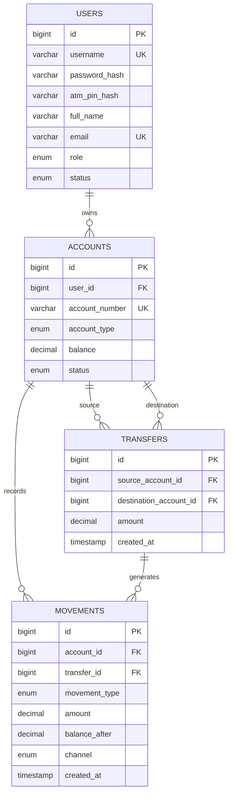

# Simulador Bancario Web — SSJ Bank

Aplicación web académica que simula banca virtual para clientes, administración bancaria y un cajero automático. Los tres módulos consultan y actualizan las mismas cuentas y movimientos almacenados en MySQL.

## Funcionalidades

- **Cliente:** inicio/cierre de sesión, consulta de cuentas y saldos, historial, transferencias, edición de datos de contacto y cambio de contraseña.
- **Administración:** dashboard, creación/búsqueda/consulta/edición de clientes, activación y bloqueo de clientes, consulta de cuentas y movimientos, y consignaciones.
- **Cajero:** identificación con número de cuenta y PIN, consulta de saldo, retiro y últimos movimientos.
- Las consignaciones, retiros y transferencias se procesan mediante transacciones de Sequelize sobre MySQL y registran movimientos inmutables. Una transferencia guarda sus dos movimientos y actualiza ambos saldos de forma atómica.
- Contraseñas y PIN se almacenan con hashes bcrypt. Las credenciales de MySQL se leen desde variables de entorno.

## Tecnologías

- Node.js, Express.js y Sequelize
- MySQL 8+ (Sequelize utiliza `mysql2` como controlador de conexión)
- HTML, CSS y JavaScript

## Integrantes

Juan Jose Agudelo
Sharon Zamora
Silvana Cardona

## Requisitos

- Node.js 18 o superior y npm
- MySQL 8 o superior

## Instalación y configuración

El proyecto se ejecuta directamente con Node.js y MySQL; no requiere Docker ni Kubernetes.

1. Clona el repositorio y entra a su carpeta.
2. Instala las dependencias:

   ```bash
   npm install
   ```

3. Crea el esquema, tablas y datos de prueba:

   ```bash
   mysql -u root -p < backend/database.sql
   ```

4. Copia `.env.example` como `.env` y configura usuario, contraseña y host de MySQL. Asigna un `SESSION_SECRET` largo y aleatorio:

   ```bash
   cp .env.example .env
   ```

5. Inicia el backend desde la raíz del proyecto:

   ```bash
   npm start
   ```

   Para desarrollo con reinicio automático:

   ```bash
   npm run dev
   ```

6. En otra terminal, sirve el frontend estático desde la raíz del proyecto:

   Linux/macOS:

   ```bash
   python3 -m http.server 5173 --directory frontend
   ```

   Windows:

   ```powershell
   py -m http.server 5173 --directory frontend
   ```

7. Abre <http://localhost:5173>. El backend API se ejecuta por separado en <http://localhost:3000/api>.

En GitHub Codespaces, abre los puertos **5173** y **3000** desde la pestaña **Ports**. El frontend detecta automáticamente el puerto remoto del backend. El origen autorizado para cookies se toma de `CODESPACE_NAME`; fuera de Codespaces configura `FRONTEND_URL` con el origen exacto del frontend (por ejemplo, `http://localhost:5173`).

## Usuarios de prueba

| Rol | Usuario | Contraseña | Cuenta | PIN de cajero |
|---|---|---|---|---|
| Administrador | `admin` | `Admin123!` | — | — |
| Cliente | `cliente1` | `Cliente123!` | `1000000001` | `1234` |
| Cliente | `cliente2` | `Cliente123!` | `1000000002` | `1234` |
| Cliente | `cliente3` | `Cliente123!` | `1000000003` | `1234` |

Los clientes de prueba comienzan con saldos distintos. Cambia las credenciales de prueba antes de cualquier despliegue; no uses este simulador para dinero real.

## Base de datos

El archivo [`backend/database.sql`](./backend/database.sql) crea la base `simulador_bancario`, tablas, llaves, restricciones y datos iniciales. La información persiste al reiniciar el servidor. El almacenamiento de sesiones del proyecto es temporal: al reiniciar el proceso, los usuarios deberán volver a iniciar sesión.

### Diagrama entidad-relación



## Estructura principal

- `backend/app.js`: configura Express y expone únicamente la API.
- `backend/modelos/`: modelos Sequelize y relaciones entre usuarios, cuentas, movimientos y transferencias.
- `backend/controladores/`: recibe las solicitudes HTTP y prepara las respuestas.
- `backend/servicios/`: autenticación, validaciones y reglas de negocio bancarias.
- `backend/rutas/`: define las rutas de autenticación, clientes, administración y cajero.
- `backend/configuracion/`: conexión de Sequelize a MySQL.
- `backend/database.sql`: esquema y datos iniciales.
- `frontend/`: interfaz responsiva independiente de la API.
- `frontend/configuracion.js`: URL pública de la API para la interfaz.
- `.env.example`: variables necesarias para conectar la aplicación.

El origen permitido para solicitudes con sesión se configura con `FRONTEND_URL` en `.env`; debe coincidir con la dirección desde la que se sirve el frontend.
